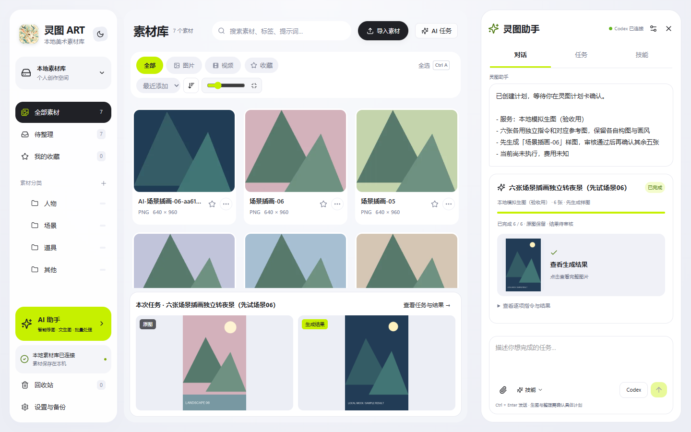
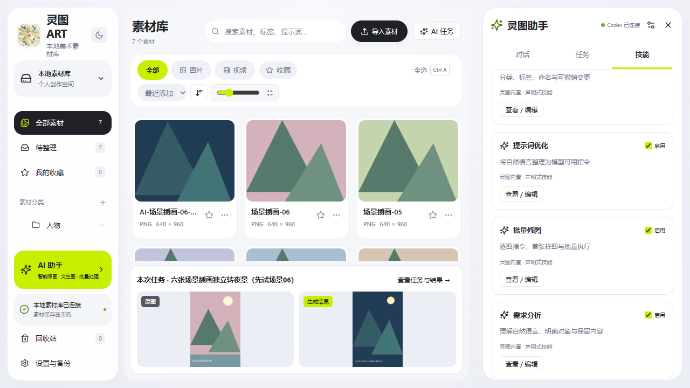
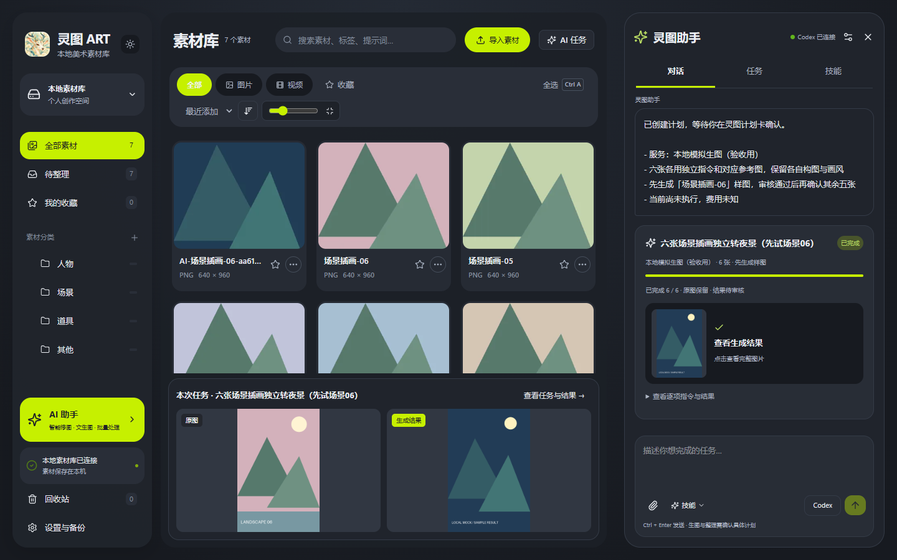
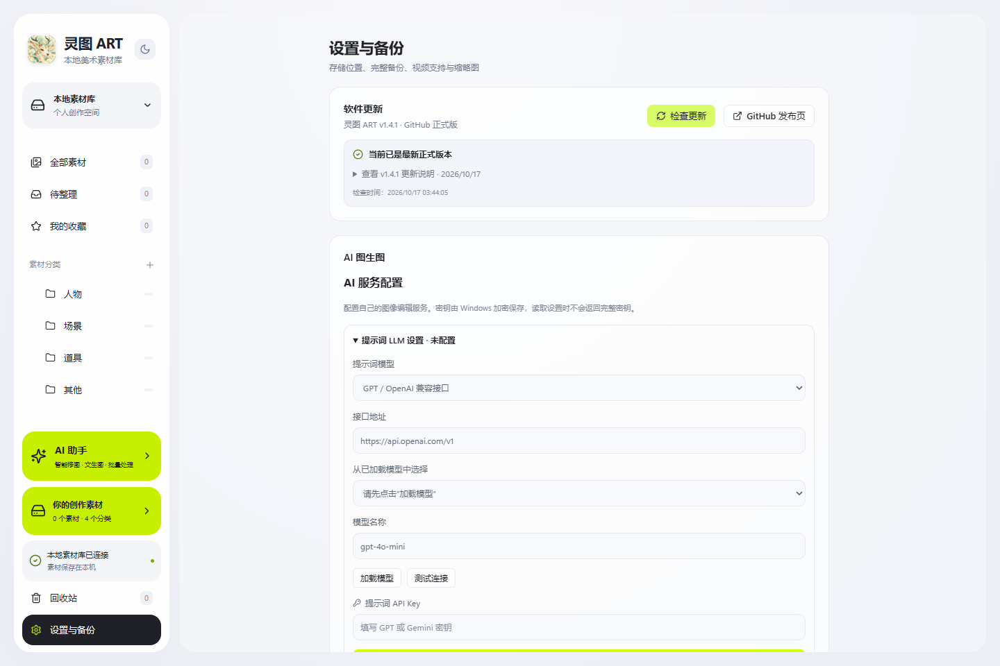
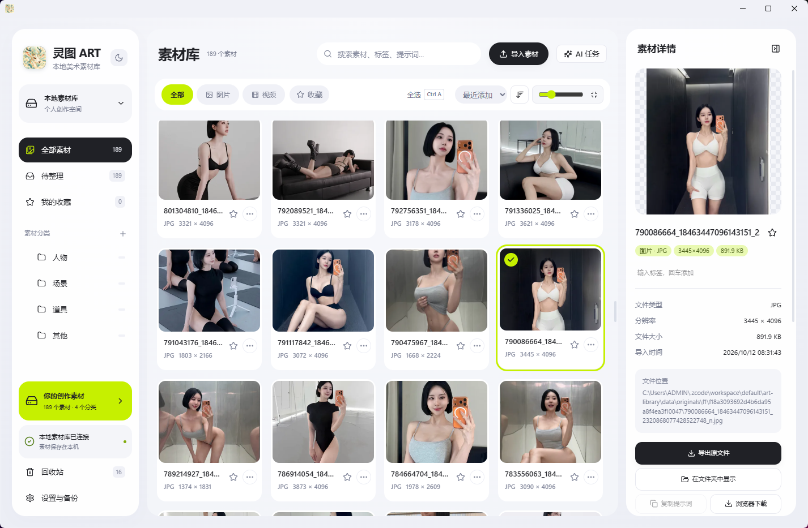

<div align="center">


# 灵图 ART

### 本地素材库 × AI 图像编辑 × 灵图助手

用自然语言整理图库、规划批量修图和生图，让素材管理与 AI 创作在同一个工作台完成。

[](https://github.com/qq911657273sr/LingTu-ART/releases/latest)
[](https://github.com/qq911657273sr/LingTu-ART/releases/latest)
[](https://www.python.org/)
[](LICENSE)

[下载 Windows 版](https://github.com/qq911657273sr/LingTu-ART/releases/latest) · [灵图助手](#灵图助手怎么用) · [界面预览](#界面预览) · [功能与隐私](#ai-图像编辑与隐私) · [从源码运行](#从源码运行)

</div>

---

## 项目简介

灵图 ART 是一款以本地素材管理为核心的美术素材工具。它把素材整理、生成信息查看和 AI 图像编辑放在同一个工作台里，适合插画、游戏美术、概念设计和其他 AI 创作流程。提供 Windows 桌面版，也可按说明部署为带单管理员登录的 Ubuntu 网页版。

素材库支持管理图片与视频、分类文件夹、标签、收藏、备注和组合搜索；查看图片时可以放大、适应窗口并浏览完整画面。需要修改素材时，可以从库中选择一张或多张参考图，描述想要的改动，再把结果与原图对照、继续编辑，或保存为新的素材。

应用默认在本机运行，素材和数据库保存在你选择的本地目录。AI 编辑和提示词助手均为可选功能，需要时再配置自己的服务。

## v1.4.1 新功能

- **灵图助手侧栏**：连接本机 Codex，结合选中的素材理解需求、分析图片并提出可执行计划。
- **批量修图与生图**：按素材制定逐项指令，先确认首张样图，再批准剩余任务；结果另存，原图保留。
- **图库整理与撤销**：让助手规划分类、标签、收藏、重命名和回收站整理，确认后执行，可撤销已完成的整理。
- **Skill 与 MCP**：内置五项技能，支持编辑和导入；本机外部 MCP 客户端可共享图库工具、提出任务计划。
- **软件更新**：在「设置与备份 → 软件更新」检查 GitHub 正式版、查看中文更新说明、下载新安装包。

[查看完整更新说明与安装包](https://github.com/qq911657273sr/LingTu-ART/releases/tag/v1.4.1)

## 界面预览

### 灵图助手 · 从需求到批量任务

在图库旁边对话、核对计划、查看生成进度和结果，不必反复切换工具。

<p align="center"></p>

> 助手截图使用独立演示图库和本地模拟生图服务展示流程，示意图不代表模型实际画质，也不包含个人素材或服务密钥。

<details>
<summary>查看技能管理与夜间模式</summary>

### Skill 技能管理

内置需求分析、批量修图、提示词优化、图库整理和批量生图规划；支持导入 SKILL.md、ZIP 与目录，按需启用。

<p align="center"></p>

### 夜间模式

<p align="center"></p>

</details>

### 应用内检查更新

从设置检查正式发布版本，阅读中文更新说明，下载后关闭旧版并安装。

<p align="center"></p>

### AI 图像编辑

<p align="center"></p>

### 本地素材库

<p align="center"></p>

## 功能特点

- **本地素材管理**：导入图片和视频，使用分类、子文件夹、标签、收藏与备注整理素材。
- **快速查找与预览**：组合搜索素材名称、标签和生成信息；支持网格浏览、全图预览、缩放和前后切换。
- **生成信息识别**：读取常见 ComfyUI、A1111/Forge、XMP 和视频工作流元数据。
- **AI 图像编辑**：从素材库或本地添加参考图，按顺序组织多张参考图，描述局部修改、换背景、调整风格或姿势等需求。
- **提示词助手与预设**：可选接入 LLM，把自然语言修改需求整理成适合所选生图服务的提示词；支持导入和管理自定义提示词预设。
- **生成记录与对照**：查看任务记录、对比原图和结果、继续编辑；按需下载结果或另存到素材库，源素材不会被覆盖。
- **备份与恢复**：将素材和库数据备份到独立目录，并在需要时恢复。
- **Windows 桌面版**：提供安装程序，也可以从源码启动本地 Web 界面。
- **应用内更新**：在「设置与备份」顶部检查本仓库 GitHub 正式版，查看中文更新说明并下载新安装包。
- **灵图助手**：连接本机 Codex，分析图片、规划批量修图/生图、提出图库整理计划；支持样图确认、Skill 管理和外部 MCP，详见 [助手使用说明](packaging/Agent助手使用说明.md)。
- **Ubuntu 网页版**：可部署在自有服务器上，通过 HTTPS 和管理员登录远程访问；部署步骤见 [Ubuntu 网页部署指南](deployment/ubuntu/README.md)。

## 灵图助手怎么用

1. 安装并登录本机 Codex CLI，在左侧「AI 助手」中连接本机 Codex。
2. 在图库勾选参考素材，用自然语言描述目标；生成服务在设置中单独配置。
3. 核对助手提出的计划、图片数量、服务和逐项指令。修图 / 生图先批准一张样图，确认效果后再批准剩余任务。
4. 在「任务」页查看进度、预览结果并标记审核状态；整理计划执行后可撤销。

| 你想完成的事 | 可以这样说 |
| --- | --- |
| 批量修改场景 | 把选中的插画改成夜景，保留构图和画风，先试一张。 |
| 从描述规划生图 | 根据这些主题各做一张概念图，先列出每张的指令让我确认。 |
| 整理素材 | 给选中的素材补充标签，并按场景和道具提出分类方案。 |

助手通过已提供的图库工具操作程序。外部 MCP 只能提出计划，执行仍在灵图内确认；首版支持 Windows 本机桌面 / 本机浏览器，尚未提供 DeepSeek 内置执行器、完整无限画布或远程 Agent 桥接。

详细步骤见 [灵图助手使用说明](packaging/Agent助手使用说明.md)。

## 下载与安装

前往 **[GitHub Releases 下载最新 Windows 安装包](https://github.com/qq911657273sr/LingTu-ART/releases/latest)**，运行 `LingTu-ART-Setup-*.exe`，然后从桌面或开始菜单启动灵图 ART。

旧版本用户首次安装 v1.4.1 后，即可通过「设置与备份 → 软件更新」检查后续版本。更新时关闭旧版再运行安装包，已有素材库与个人配置保留。

安装程序包含应用运行环境和 FFmpeg；如果系统缺少 WebView2，安装程序会提示安装。首次启动后，选择素材库目录并导入图片或视频即可使用基础素材管理功能。

## AI 图像编辑与隐私

AI 图像编辑不是使用素材库的前提。你可以在应用设置中自行配置 OpenAI 兼容接口、Gemini 或 RunningHub 服务，以及相应的模型、工作流和 API Key。提示词助手可单独配置兼容 OpenAI 的 LLM 接口。灵图助手使用本机 Codex 登录，和提示词 LLM 配置分别管理；Codex 对话与图片生成由各自服务计费。

项目源码和公开发行包不包含个人 API Key，也不预置个人的生图或 LLM 服务地址。Windows 桌面版使用 DPAPI 加密保存服务凭据；Ubuntu 网页版使用独立 Fernet 密钥加密，并要求管理员登录。提交生成任务时，所选参考图和提示词会发送给你配置的服务提供方，并受其服务条款与隐私政策约束；未配置服务时，AI 功能不可用。

更多配置步骤见[AI 图生图使用说明](packaging/AI图生图使用说明.md)。

## 从源码运行

需要 Windows 10/11 x64、Python 3.12 和 FFmpeg/ffprobe。Node.js 22 仅在修改或重新构建前端时需要。

```powershell
git clone https://github.com/qq911657273sr/LingTu-ART.git
cd LingTu-ART
.\安装.bat
.\启动素材库.bat
```

首次安装脚本会创建 Python 虚拟环境并安装依赖。浏览器界面默认运行在 `http://127.0.0.1:8765`；关闭启动窗口即可停止本地服务。前端源码位于 `web/src/`，修改后在 `web/` 目录运行 `npm ci` 和 `npm run build`。

## 从源码构建 Windows 安装包

版本号统一保存在根目录 `version.ini`。维护者更新版本与 `docs/RELEASE_NOTES.md` 并同步到 `main` 后，GitHub Actions 会自动测试、构建并创建对应 Release；已经发布的相同版本不会自动覆盖。程序的更新按钮从 GitHub 最新正式 Release 获取版本与安装包链接。

安装 Python 3.12、Node.js 22、FFmpeg 和 [Inno Setup 6](https://jrsoftware.org/isinfo.php)，然后在仓库根目录运行：

```powershell
Set-ExecutionPolicy -Scope Process Bypass
.\packaging\build-windows.ps1
```

安装包会生成在 `output/installer/`。第三方组件许可见 [THIRD_PARTY_NOTICES.md](THIRD_PARTY_NOTICES.md)。

## 验收测试

在 Windows 且已安装项目依赖的环境中运行：

```powershell
.\.venv\Scripts\python.exe tests\acceptance.py
.\.venv\Scripts\python.exe tests\ai_acceptance.py
```

验收使用临时素材目录和本地模拟服务，不会调用付费 AI 服务，也不会修改现有素材库。

## 许可证

灵图 ART 使用 MIT 许可证。第三方组件保留各自许可证，详情见 [THIRD_PARTY_NOTICES.md](THIRD_PARTY_NOTICES.md)。

<div align="center">

**LingTu ART** — a local-first art asset library and AI image editing workspace for Windows.

</div>
